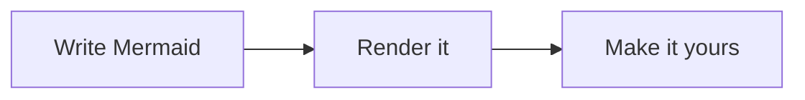

# Marazmatic

Mermaid diagrams, rendered directly in your terminal. No browser, JavaScript runtime, image protocol, or Mermaid installation required.



```text
╭───────────────╮            ╭───────────╮            ╭───────────────╮
│ Write Mermaid ├───────────╼┥ Render it ├───────────╼┥ Make it yours │
╰───────────────╯            ╰───────────╯            ╰───────────────╯
```

## Run

Install a current stable Rust toolchain, then:

```sh
cargo run -- assets/example.mermaid
cargo run -- live assets/flowchart.mmd
cargo install --path .
```

Once installed:

```sh
marazmatic assets/example.mermaid
marazmatic live assets/example.mermaid
marazmatic --live assets/sequence.mmd
marazmatic assets/state.mmd --border double --theme ember
marazmatic assets/flowchart.mmd --direction TB --gap 6
```

## Output modes

```sh
# Rich Unicode drawing, no colors or font styles; no ANSI escapes.
marazmatic diagram.mmd --plain

# ASCII borders, connectors, and arrows, with no ANSI escapes.
marazmatic diagram.mmd --plain --ascii

# Force ANSI colors and bold / italic / underline in redirected output.
marazmatic diagram.mmd --color always --style always

# Control colors and font styles independently.
marazmatic diagram.mmd --color always --no-style
marazmatic diagram.mmd --color never --style always

# Read stdin, save a full diagram, or page through a large diagram.
cat diagram.mmd | marazmatic
marazmatic - < diagram.mmd
marazmatic diagram.mmd --plain -o diagram.txt
marazmatic diagram.mmd --color always --style always | less -RS
```

Colors and accents are automatic on an interactive terminal. Pipes and output files default to plain Unicode text. `NO_COLOR` disables automatic colors when set to a nonempty value; `TERM=dumb` disables automatic colors and accents. `--plain` overrides both forced policies. `--ascii` changes drawing characters; source labels retain their original Unicode text.

Border styles: `rounded` (default), `square`, `double`, `heavy`, `ascii`.
Palettes: `ocean` (default), `ember`, `forest`, `mono`.

Unicode connection tips use `╼`, `╽`, `╾`, and `╿` for right, down, left, and up, with the heavy end facing the destination. The box border joins each tip with a matching junction, such as `╼┥`, preserving the box's border weight and color. ASCII drawing uses `>`, `v`, `<`, and `^` with `+` junctions.

Labels wrap by terminal display width. CJK, combining marks, and emoji clusters stay aligned. Edge labels, sequence messages, and note text use inverted colors with `🭮█label█🭬` decoration; ASCII drawing uses `[ label ]`. Edge and message labels are centered directly on their connector lines. Node text is bold and edge labels are italic when accents are enabled. Inline `**bold**`, `*italic*`, and backtick code (underlined) are also supported. Colors and styles disappear cleanly in plain output without changing the layout or decoration.

## Live viewer

```sh
marazmatic live diagram.mmd
```

Save the Mermaid file in your editor to update the view. The viewer checks for changes every 250 ms, supports atomic file replacement, and keeps the last good render visible while an edit is invalid or the file is temporarily missing. Initial parse errors also recover as soon as the file is fixed.

| Key | Action |
| --- | --- |
| `b` | Cycle border styles |
| `a` | Toggle ASCII drawing |
| `t` | Cycle color palettes |
| `c` / `s` | Toggle color / font style accents independently |
| `d` | Cycle source direction / TB / LR / BT / RL for graphs |
| `+` / `-` | Increase / decrease spacing (2–12) |
| `[` / `]` | Decrease / increase label wrap width (8–80 columns) |
| `p` | Cycle horizontal node padding (0–3) |
| `v` | Toggle edge / message labels |
| Arrow keys or `h j k l` | Pan; Shift + arrows moves faster |
| Mouse wheel | Pan vertically or horizontally |
| Page Up / Page Down | Scroll a page |
| `g` / Home | Return to the origin |
| `G` / End | Scroll to the bottom |
| Tab | Toggle the settings panel (shown on wide terminals) |
| `w` / `r` | Pause or resume watching / reload now |
| `e` | Export the entire diagram as plain text alongside the source |
| `0` | Restore startup settings and viewport |
| `?` | Show help; `?`, Escape, or Enter closes it |
| `q`, Escape, or Ctrl+C | Quit |

Exports use `name.marazmatic.txt`, then `name.marazmatic-1.txt`, etc., preserving existing files. Live mode needs an interactive, cursor-addressable terminal; 80 × 24 or larger is comfortable. It restores raw mode, the cursor, and the previous screen on normal exits, IO errors, and Rust panics. Rendering settings are local to the running viewer.

## Mermaid support

This is a terminal renderer for a documented subset of Mermaid. It uses its own parser and layout engine rather than embedding Mermaid's SVG renderer. Rounded and circular shapes, decisions, and actors use compact terminal approximations.

| Diagram | Supported syntax |
| --- | --- |
| `flowchart` / `graph` | TB/TD, BT, LR, RL; implicit and explicit nodes; quoted and multiline labels; chained edges; `&` node groups; labeled edges; solid, dotted, thick, undirected, bidirectional, circle, and cross arrows; cycles, self loops, disconnected nodes |
| Flowchart shapes | `A[text]`, `A(text)`, `A([text])`, `A{text}`, `A{{text}}`, `A((text))`, `A(((text)))`, `A[(text)]`, `A[[text]]` |
| `sequenceDiagram` | Participants and actors, `as` aliases, implicit participants, messages (`->>`, `-->>`, `->`, `-->`, `-x`, `--x`, `-)`, `--)`, bidirectional `<<->>` / `<<-->>`), self messages, `autonumber`, explicit and inline activations, notes over/left/right, nested loop/alt/opt/par/break/critical/rect blocks and their branches |
| `stateDiagram` / `stateDiagram-v2` | Named states, aliases, descriptions, labeled transitions, `[*]` initial/final states, direction, cycles |
| Shared | `%%` comments, `<br>` line breaks, Markdown / HTML emphasis, common HTML entities, one Mermaid fenced block in Markdown, YAML front-matter title |

Subgraphs, composite states, class and ER diagrams, the remaining Mermaid diagram families, newer `@{ ... }` shape syntax, sequence participant grouping, and arbitrary Mermaid configuration are not implemented. Unsupported structural syntax produces a line-numbered error. CSS/class/click directives and front-matter config are ignored with a warning; terminal themes control presentation. Files with several fenced Mermaid blocks render the first one.

Graph layout orders branches across every layer, including edges that skip nodes, to reduce crossings. Connections use separate attachment points and parallel routing lanes, with space reserved for centered labels. Box placement follows the actual attachment points so small offsets do not introduce extra bends. Whole-route refinement looks for clear paths with at most four turns, moving labels along their connections when needed. More complex routes remain available around obstacles. Cycles and self loops route around the forward connections. Dense diagrams can become wide; pan in live mode, change direction or wrapping, or export the full canvas. Limits are 1 MiB of source, 256 nodes/participants, 1024 graph edges, 4096 sequence events, 16 nested sequence blocks, and a canvas of at most 4096 columns/rows and one million cells.

See the [Mermaid flowchart syntax](https://mermaid.js.org/syntax/flowchart.html), [sequence syntax](https://mermaid.js.org/syntax/sequenceDiagram.html), and [state syntax](https://mermaid.js.org/syntax/stateDiagram.html) for the upstream language.

## Library

```rust
use marazmatic::{parse, render, RenderOptions, Theme};

fn main() -> Result<(), Box<dyn std::error::Error>> {
    let diagram = parse("flowchart LR; A[Hello] --> B[Terminal]")?;
    let canvas = render(&diagram, &RenderOptions::default())?;
    let plain = canvas.to_text(false, false, Theme::Ocean);
    let ansi = canvas.to_text(true, true, Theme::Ocean);
    print!("{plain}");
    Ok(())
}
```

## Development

```sh
cargo fmt --check
cargo clippy --all-targets -- -D warnings
cargo test
cargo build
python3 tests/live_smoke.py
cargo build --release
```

The Python smoke test uses a real Unix pseudo-terminal and only the standard library. It covers rendering controls, independent colors and accents, help, invalid edits, atomic saves, deleted-file recovery, paused watching, exports, resize, quitting, Ctrl+C, and terminal restoration.
